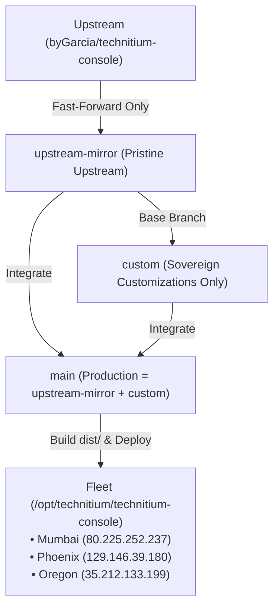

# 🌿 SentinelLabs Branching Strategy & Lifecycle Architecture

> **📌 Target Repository:** `varunagarwal-pro/Technitium-WebUI`  
> **📅 Version:** 2.0.0 (Unified 5-Role Branch Standard — Tier C)  
> **👤 Lead Maintainer:** Varun Agarwal (Sentinel Labs)

---

## 🧭 1. Architectural Overview & Philosophy

The branching strategy for `Technitium-WebUI` follows the **SentinelLabs Unified 5-Role Branch Standard (Tier C)** documented in [`D:\SentinelLabs\Docs\Upstream-Sync-Manual.md`](../../../Docs/Upstream-Sync-Manual.md):

1. **`upstream-mirror`** *(Read-Only Pristine Mirror)*: Fast-forwarded replica of `byGarcia/technitium-console`. Zero local commits.
2. **`custom`** *(Sovereign Customizations)*: Based directly on `upstream-mirror`, holding **only** our long-lived SentinelLabs customizations (replaces legacy `sentinel-customizations`).
3. **`feat/*` / `fix/*` & `upstream-try-merge`** *(Disposable)*: Short-lived branches for upstream PRs or trial merges, deleted upon merge.
4. **`main`** *(Integrated Production Branch)*: `upstream-mirror` + `custom` + any approved feature branches. Built, tested, and deployed directly to `/opt/technitium/technitium-console` across Mumbai, Phoenix, and Oregon (replaces retired `deploy/sentinel-console`).

---

## 🗂️ 2. Active Branches

### 🔵 `upstream-mirror` — Pristine Upstream Mirror
- **Role:** Read-only upstream tracking branch (`byGarcia/technitium-console`).
- **Invariants:** Strictly zero local commits; maintained by SentinelOrbit `fleet-upstream-sync`.

### 🛡️ `custom` — Sovereign Customizations
- **Role:** Rebased cleanly on `upstream-mirror`; holds **only** Sentinel-specific enhancements not intended for upstream:
  - **Sovereign Themes:** Dark Grey, Amber (phosphor amber & gold), and Glassmorphism (frosted acrylic sky glow) with `>= 4.5:1` WCAG AA contrast compliance and `ThemeChoice.tsx` selector support.
  - **Footer Attribution:** `byVarun` custom theme attribution in `src/app/footer.ts` and `src/ui/FooterLinks.tsx`.
  - **Duration Spacing:** Human-readable spacing in TTL displays (`24d 6h`, `15m 32s`) in `src/screens/lists/record.ts`.
  - **Cross-Platform Tooling & Governance:** `fileURLToPath` Windows build/test fixes, `.coderabbit.yaml`, `.github/workflows/upstream-gate.yml`, `Tasks.md`, and `docs/BRANCHING_STRATEGY.md`.

### 🚀 `main` — Integrated Production Branch
- **Role:** Combines `upstream-mirror` + `custom` (and any new approved branches).
- **Target Directory:** Compiled `dist/` bundle deployed to `/opt/technitium/technitium-console` via `/etc/systemd/system/dns.service.d/console.conf` (leaving stock `/opt/technitium/dns/www` untouched).

---

## 🗄️ 3. Retired Branches

- **`feat/telemetry-visual-enhancements` (PR #37):** Merged upstream (`0b98183`, released in `v1.4.4`); branch deleted locally and on `origin`.
- **`feat/display-timezone` (PR #38):** Merged upstream (`f2c7859`, released in `v1.4.4`); branch deleted locally and on `origin`.
- **`sentinel-customizations`:** Superseded by `custom`; deleted locally and on `origin`.
- **`deploy/sentinel-console`:** Superseded by `main`; deleted locally and on `origin`.

---

## 🔄 4. Upstream Sync & Release Workflow

1. **Sync Mirror:** Fast-forward `upstream-mirror` when upstream releases a new version.
2. **Rebase `custom`:** Rebase `custom` onto `upstream-mirror` so `custom` always stays clean and contains only sovereign changes.
3. **Integrate `main`:** Merge `upstream-mirror` and `custom` into `main`, run `npm run lint`, `npm run typecheck`, `npm test`, and `npm run build`.
4. **Deploy Fleet:** Deploy `dist/` from `main` to Mumbai, Phoenix, and Oregon.
